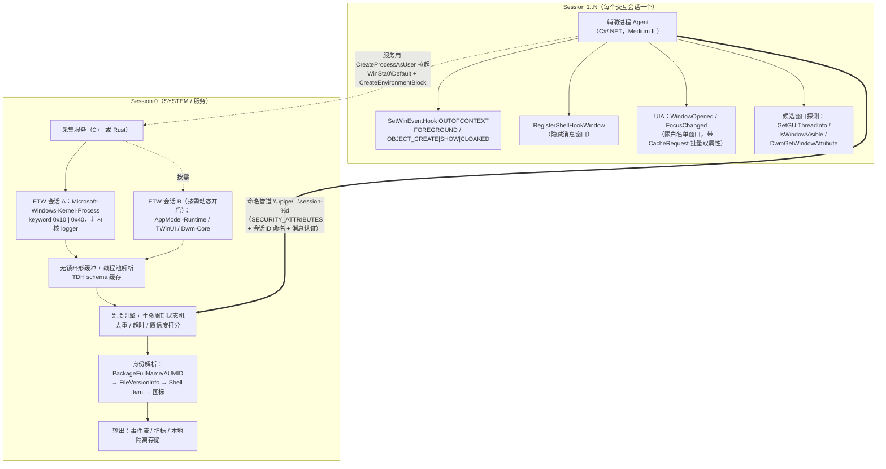
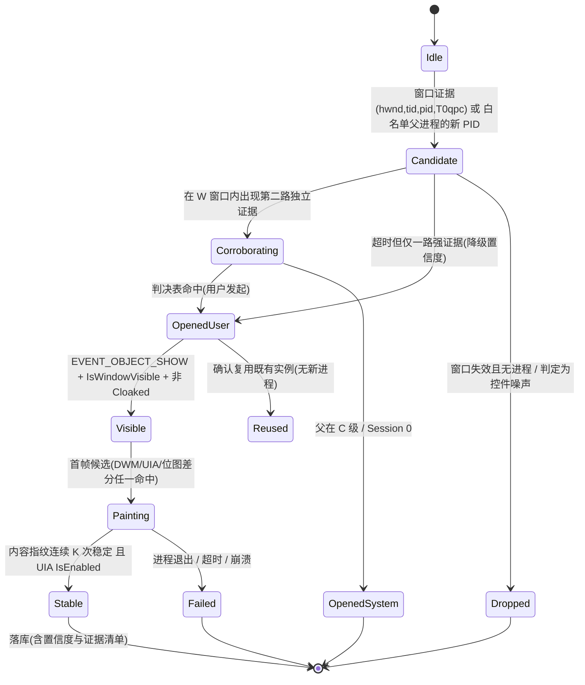

# Windows 10/11 桌面应用「用户发起打开」观测与启动耗时测量：低开销采集架构与工程落地报告

> 资料核实截止日期：2026-09-01。文中标注为「实验性/非官方」的能力均缺乏 Microsoft 正式文档承诺，不得作为生产契约。

## 摘要：结论先行

**结论一：不存在单一 API 能同时回答"用户打开了哪个应用"和"它多久才出来"。** 必须做双层融合：内核 ETW 的 `Microsoft-Windows-Kernel-Process`（GUID `{22FB2CD6-0E7B-422B-A0C7-2fad-1fd0e716}`，keyword `0x10`）提供**不漏进程**的事实底座——它与 `PsSetCreateProcessNotifyRoutineEx` 同源，短生命周期进程也无法逃过；而"用户发起"这个语义只能由用户会话内的辅助进程用 WinEvent（`EVENT_SYSTEM_FOREGROUND`）+ Shell hook + UIA 焦点事件去猜，因为 Session 0 服务在架构上被禁止触碰用户桌面 [1][2]。

**结论二：默认最低损耗方案 = 常驻服务只跑一个非内核 ETW 会话（Process keyword 0x10 + Image keyword 0x40），加每会话一个 Medium IL 辅助进程。** 服务侧零 GUI、零注入、零轮询；辅助进程只订阅 WinEvent 与 RegisterShellHookWindow，把 `(hwnd, tid, pid, 时间戳)` 通过命名管道回传。任何"服务里直接 EnumWindows / GetForegroundWindow / CoCreateInstance(CLSID_CUIAutomation)"的设计在现代 Windows 上都是无效代码 [3][4]。

**结论三：启动耗时只能分层定义，其中"第一帧"在没有应用配合时不可准确观测。** 可准确观测的是 T1 进程创建（ETW ProcessStart 的 CreateTime/时间戳）与主窗口创建（WinEvent `EVENT_OBJECT_CREATE` / Shell `HSHELL_WINDOWREPLACING`）；"首次可见/绘制"可用 `EVENT_OBJECT_SHOW` + `IsWindowVisible` + UIA `WindowOpenedEvent` 得到**上界近似**；真正的 GPU present 帧需要 DWM 私有 provider（逆向所得 GUID）或 DXGI Desktop Duplication 采样，开销与稳定性都不适合常驻 [5]。因此报告给出的输出是**带置信度的区间**，不是一个看似精确的毫秒数。

**结论四：不要优先采用轮询、全局窗口钩子、DLL 注入或内核驱动。** 轮询必然漏掉毫秒级进程（这是架构缺陷而非调参问题）；`SetWindowsHookEx` 跨桌面无效且 `WINEVENT_INCONTEXT` 会向每个 GUI 进程注入 DLL；AMSI 与"打开应用观测"完全无关，它是脚本内容扫描接口 [6]；内核驱动换来的是 EV 签名 + HLK + HVCI 兼容的长期成本，而 ETW 已经给了同源数据。

**结论五：语言选型上，服务用 C++ 或 Rust，辅助进程用 C#/.NET。** 服务侧的要求是"零 GC 抖动、可控的回调路径、直接面对 `EVENT_RECORD`"，C++（krabsetw 风格）最稳，Rust（`etw-rs` 等薄封装）在内存安全上更优但生态成熟度明显更低 [7]；辅助进程要调 UIA/MSAA、COM、WinForms 消息泵，C# 的开发效率优势压倒性。Go 在 ETW 消费与 COM/UIA 两侧都没有成熟绑定，不建议。

## 一、问题定性：这是两个问题，不是一个

**"用户打开了什么"与"进程被创建了什么"之间的差集，正是本需求的全部难度。** 内核只看到 `ProcessStart`；它不区分双击快捷方式、协议唤起、COM 激活、任务计划、服务拉起、浏览器渲染子进程、还是应用自检重启。而需求方真正关心的是前者。把 ETW 进程事件直接上报为"用户打开应用"，会同时产生三类错误：

**多报（false positive）**：一个用户双击 Chrome，产生的是 chrome.exe + 若干 renderer/gpu/utility 子进程 + 可能已有的崩溃上报进程；双击一个 Electron 应用产生 4–8 个进程；UWP 应用走 `ApplicationFrameHost.exe` 宿主，真正的包身份在子进程 [8]。若不做进程树归并，一次用户动作会被记成五六次"打开"。

**少报（false negative）**：单实例应用（多数现代桌面应用、几乎所有 UWP）第二次激活不创建新进程，只是给已有进程发消息、复用或新建窗口。此时 ETW 完全没有进程事件，唯一信号是窗口层的 `HSHELL_WINDOWACTIVATED` / `EVENT_SYSTEM_FOREGROUND` / UIA `WindowOpenedEvent`。只挂 ETW 会系统性地漏掉"用户第二次打开"这一高频场景。

**误归属（mis-attribution）**：`CreateTime` 与父进程链在系统内部会被"回收"——Explorer 启动进程后退出（常见的 launcher stub、MSI bootstrapper、Elevation 的 `consent.exe` 中转、`AppInfo` 服务提权），PPID 指向的是一个已退出的临时进程；而 `ProcessSequenceNumber` 才是内核侧的稳定序号（ETW ProcessStart 同时给 `ProcessID`、`ParentProcessID`、`ProcessSequenceNumber`、`ParentProcessSequenceNumber`、`SessionID`、`ProcessTokenIsElevated`、`MandatoryLabel`、`PackageFullName`、`PackageRelativeAppId`）[9]。用 PPID  alone 建树必然断链。

所以架构上必须接受一个前提：**内核事件负责"不漏"，用户会话事件负责"是谁"，两者用多键关联在服务端合并，并且承认存在不可判定的子集。**

## 二、能力盘点：每个信号源能给你什么，以及它的硬边界

下表是本次核实的核心结论。凡"无官方文档"者，一律不得作为生产依赖。

| 信号源 | 提供什么 | 系统版本/权限 | 致命边界 |
|---|---|---|---|
| `Microsoft-Windows-Kernel-Process`（`{22FB2CD6-…}`） | ProcessStart/Stop、ImageLoad，含 PID/PPID/SequenceNumber/SessionID/ImageName/令牌提权/MandatoryLabel/**PackageFullName+PackageRelativeAppId** | Win7+；需 Admin 或 Performance Log Users 或 LocalSystem/Service [10] | **不携带 CommandLine**；ImageName 是 `\Device\HarddiskVolumeN\...` 需转换；kernel provider 只能进 NT Kernel Logger 或经 `EnableTraceEx2` 附着 [11] |
| `EVENT_TRACE_FLAG_PROCESS` / 经典 NT Kernel Logger | 同上但走 `EVENT_TRACE_PROPERTIES.EnableFlags` | 全版本 | **单例**：全机只能有一个 "NT Kernel Logger" 会话，与 EDR/PerfView/WPR 直接冲突 [11] |
| `WINEVENT_KEYWORD_JOB` (0x400) / `JOB_IO` (0x1000) / `WORK_ON_BEHALF` (0x800) | Job 归属、IO 归属、委托令牌 | Win8+（Job 相关） | 语义随版本变化，需实测；Job 归属对"浏览器多进程归并"有价值但与 Chrome 自身 Job 策略耦合 |
| `SetWinEventHook` `EVENT_SYSTEM_FOREGROUND` (0x3) | 前台窗口切换，含 `HWINEVENTHOOK, event, hwnd, idObject, idChild, idThread, time` | Vista+；`WINEVENT_OUTOFCONTEXT` 无需注入 | **只对调用线程所在桌面有效**；服务在 Session 0 收不到任何用户桌面事件 [12]；`hwnd` 可能撞上 `EVENT_OBJECT_CREATE` 的 0x8000 区间噪声 |
| `EVENT_OBJECT_CREATE` (0x8000) / `SHOW` (0x8002) / `DESTROY` (0x8001) / `CLOAKED` (0x8017) / `UNCLOAKED` | 窗口对象生命周期；Cloak 是 UWP/现代应用的隐藏态 | Vista+ | 系统**同时**为控件、插入符、工具栏发这些事件，必须靠 `idObject==OBJID_WINDOW && idChild==CHILDID_SELF` + 顶层窗口判定过滤 [13] |
| `RegisterShellHookWindow` + `SHELLHOOK` 消息 | `HSHELL_WINDOWCREATED/DESTROYED/ACTIVATED/RUDEAPPACTIVATED/WINDOWREPLACING/WINDOWREPLACED/REDRAW/FLASH/APPCOMMAND` | Win2000+；**仅需一个隐藏窗口，无需注入 DLL** | 官方明确标注"**不适用于通用目的，后续版本可能改变或不可用**"[14]；消息只发给与注册窗口同桌面的 shell 窗口；`HSHELL_WINDOWCREATED` 会为同一个 Notepad 窗口发两次（含内部临时窗口），必须去重 |
| `GetForegroundWindow` / `GetGUIThreadInfo(0, …)` | 前台线程/窗口/焦点 | 全版本 | 只能在用户会话内调用；切换瞬间可能返回 NULL（须当"未知"而非"无前台"）；`GetFocus` 只报调用线程自己的队列 [15] |
| UI Automation（`IUIAutomation`，`WindowPattern.WindowOpenedEvent`，`AddAutomationFocusChangedEventHandler`，`StructureChangedEventHandler`） | 窗口打开、焦点、结构变化；`IsEnabled`/`IsKeyboardFocusable` 判可交互 | Vista+；.NET 3.0+ | **跨进程 COM 调用，逐属性逐个元素的 IPC 代价高**；UIPI 下低完整性客户端看不到高完整性目标（UIA3 比 UIA2 更严）[16]；要跨完整性级别需 `uiAccess=true` + **受信任根签发的代码签名**，这是发布期硬成本 [17]；UWP/AppContainer 应用常需 MSAA 兜底 |
| MSAA（`AccessibleObjectFromWindow/Event`，`IAccessible`） | 窗口名、状态、UWP 兜底 | Win95+/oleacc | 无事件时只能拉；信息贫乏；同样受 UIPI 约束 |
| `GetPackageFullName` / `GetApplicationUserModelId`（传入进程句柄） | 打包应用的 Package Full Name 与 AUMID | Win8+；`PROCESS_QUERY_LIMITED_INFORMATION` 即可；`APPMODEL_ERROR_NO_PACKAGE`(15700) 表示非打包 [18] | 短生命周期进程可能拿不到句柄；需在进程退出前完成，故必须在 ETW 回调路径上同步做或立刻把 PID 交给池化线程 |
| `QueryFullProcessImageNameW` | 镜像完整路径 | Vista+；`PROCESS_QUERY_LIMITED_INFORMATION` 足够 | 对受保护进程/已退出进程返回失败；**与 PID 复用存在 TOCTOU**，必须配合 `CreateTime` 校验 |
| `GetFileVersionInfoW` / `GetModuleHandle` 版本资源 | FileDescription / ProductName（"应用名"的中文/本地化展示名） | 全版本 | 需打开目标文件读取，跨会话没问题但有 IO 成本；很多应用不填或填错；应缓存并按 `(path, size, mtime)` 失效 |
| Shell 层：App Paths、`ShellExecuteEx`、协议 handler、`.lnk`、拖放 `DropTarget`/`CFSTR_SHELLIDLIST` | "用户点的是什么" | 全版本 | **没有官方 ETW provider 可靠覆盖 ShellExecute 解析过程**；`Microsoft-Windows-Shell-Core`（`{30336ED4-E327-447C-9DE0-51B652C86108}`）与 `Microsoft-Windows-Desktop-Shell-Windowing`（`{F84AA759-31D3-59BF-2C89-3748CF17FD7E}`）的 GUID 来自逆向工程，社区工具在用但微软不承诺 [19]；任务栏/搜索的激活路径更是完全不透明 |
| `Microsoft-Windows-AppModel-Runtime` / `Microsoft-Windows-TWinUI/Operational` | 打包应用激活与应用**失败**原因（如 0x8027025a 启动超时、AUMID、ContractId）[20] | Win10+ | 只有 Admin 通道与 Operational 通道可用，事件集随版本变；成功激活的实际事件编号未文档化，需逐版本 `logman query providers` 复核 |
| Job Objects（`CreateJobObject` + `AssignProcessToJobObject` + `JOBOBJECT_ASSOCIATE_COMPLETION_PORT`） | 进程树归属、树整体存活通知 | Win8+ 支持嵌套 Job | **它不是观测机制而是控制机制**：默认子进程**不继承** Job，除非设置 `JOB_OBJECT_LIMIT_BREAKAWAY_OK` 且子进程未带 `CREATE_BREAKAWAY_FROM_JOB`；设了 `KILL_ON_JOB_CLOSE` 会杀掉用户应用（绝不可用于观测目的）[21]；且只能覆盖"你自己拉起的"那棵子树，对 Explorer/Start 拉起的应用无效 |
| AMSI（`AmsiScanBuffer` 等） | 脚本/缓冲区内容扫描结果 | Win10+ | **与进程创建、窗口、启动耗时无关**。它是给脚本宿主和"接受任意内容的应用程序"调用的扫描接口，覆盖 PowerShell/JScript/VBScript/VBA/.NET 程序集加载/WMI [6][22]。用它做"应用打开观测"是方向性错误。唯一相关点是：若产品同时做安全检测，可把"高完整性提权场景"与 AMSI 结果做旁证关联 |

**三个必须澄清的高频误解：**

第一，**Shell hook 不等于"全局窗口创建通知"**。`RegisterShellHookWindow` 的官方文档用词是"注册指定的**shell 窗口**以接收对 **shell 应用程序**有用的事件"，且明确"收到的事件消息只会发送到与该窗口桌面关联的 shell 窗口"[14]。它是 Explorer 任务栏自己用的通道，不是内核窗口管理器广播。它够用，但它不等价于"看见所有窗口"。

第二，**`WINEVENT_INCONTEXT` 就是 DLL 注入**。MSDN 的服务端钩子说明指出，钩子 DLL 会被自动加载进目标进程 [12]；而 `WINEVENT_OUTOFCONTEXT` 才是把事件 marshalling 回调用进程。选后者，一个字节都不注入。

第三，**"服务 + 勾选允许与桌面交互"在现代 Windows 上是死路**。自 Vista 起服务固定在 Session 0，进程只能拿到 Session 0 的窗口站与桌面句柄 [3]；`UI0Detect` 自 Windows 10 1803 起已移除。微软给出的唯一正解是：服务用 `WTSSendMessage` 显示简单对话框，或**用 `CreateProcessAsUser` 在交互用户上下文里拉一个隐藏 GUI 应用，再用命名管道 IPC 双向通信** [2]。这就是本报告的架构基础。

## 三、推荐架构：服务只做内核侧，用户会话只做 UI 侧



**分层职责必须严格，否则开销和正确性同时崩。**

服务层只做三件事：持有 ETW 会话、解析 `EVENT_RECORD`、跑关联状态机。**它不调任何 user32/GDI/UIA/COM UI 接口**。原因不只是 Session 0 拿不到句柄，还在于一旦在服务里同步调 UIA，你就会在高权限上下文里对不可信目标进程做跨进程 COM 调用——这既是一个提权攻击面，也会因为目标进程挂起而把服务线程卡死（UIA 调用没有可靠的超时保证）。

辅助进程层只做一件事：**把"用户语义"变成带时间戳的结构化元组**。它跑在 Medium IL、不提权、不申请 `uiAccess`（除非明确需要观测提权应用，见下），崩溃了由服务重启，不影响数据底座。它必须有一个真正的消息泵：`SetWinEventHook` 的 out-of-context 回调和 Shell hook 消息都靠投递到安装线程的消息队列，线程不泵消息就会导致系统侧投递阻塞 [23]。

**IPC 设计要点**：管道名带会话 ID（微软官方建议"为每个管道提供基于会话 ID 的唯一名称以区分多个用户进程"）[2]；服务端用 `SECURITY_ATTRIBUTES` 限定为 LocalSystem + 该用户 SID；消息里必须带 `(agentBootId, seq)` 以便检测丢消息与重连；**所有时间戳在辅助进程侧用 `QueryPerformanceCounter` 打，不依赖到达顺序**，因为管道投递有抖动，而 ETW 的 `ProcessTrace` 本身也不保证严格时序（跨 CPU 同时间戳事件顺序不可预测，官方文档明确要求用 QPC 时钟而非系统时间）[24]。

**为什么用动态 trace session 而不是常开全家桶**：`Microsoft-Windows-Kernel-Process` 常开是廉价的（进程/镜像事件频率本身低），但 AppModel-Runtime、TWinUI、Dwm-Core 这类 provider 的日志量随版本和负载不可控。做法是：基线只开 Kernel-Process；当状态机出现"有前台切换但无进程事件且无窗口事件"的可疑空隙、或用户配置了某应用的深度诊断时，`EnableTraceEx2` 动态加挂 30–60 秒再摘掉。ETW 支持每会话多 provider、provider 与会话多对多 [11]，这比常驻全开划算得多。

**会话数配额是真实约束**：ETW 全机最多 64 个会话（Windows 10 起部分系统可更多），且同名会话唯一、**NT Kernel Logger 单例** [11]。生产上必须先 `QueryAllTraces` 探测冲突：若已有 EDR 占用了 kernel logger，不要去抢（会导致对方或自己失败），退化为只用 `Microsoft-Windows-Kernel-Process` 的 manifest 通道。安装期就应把"与现有 EDR/PerfView 的 ETW 冲突"列为兼容性测试项。

## 四、区分"用户发起打开"：归因策略、关联键与判决表

**核心判据不是"谁创建了进程"，而是"在时间窗口内，是否存在一条从用户输入到该进程/窗口的可信路径"。** 我们把证据分成三级：

**A 级（强证据，可直接判用户发起）**：辅助进程在 `[T0-W, T0]` 内观测到前台切换或窗口创建，且该窗口的 `GetWindowThreadProcessId` 命中目标 PID 或其已归并的进程组；或 Shell hook 的 `HSHELL_WINDOWACTIVATED` 命中；或 UIA `WindowOpenedEvent` 命中且元素 PID 匹配。

**B 级（中证据，需结合父链）**：父进程属于"用户代理白名单"——`explorer.exe`（双击/任务栏/开始菜单/Win+R）、`SearchApp.exe` / `SearchHost.exe`（搜索）、`ApplicationFrameHost.exe`（UWP 宿主）、`StartMenuExperienceHost.exe`、`cmd.exe`/`powershell.exe`/`conhost.exe` 仅在交互会话且祖先链能追到 explorer 或已确认的终端前端、`svchost.exe` 承载的 `ShellServiceHost`/`DcomLaunch`（协议与 COM 激活）、`consent.exe`/`AppInfo` 服务（UAC 提权中转，须把 `consent.exe` 视作透明代理，把归因穿过它传到它的父）。

**C 级（弱证据/反证据）**：父进程为 `services.exe`、`svchost.exe` 的非交互承载、`WmiPrvSE.exe`、`schtasks`/`taskeng`、`msiexec`（非交互）、`OfficeClickToRun`、自更新器、以及父进程在 Session 0。这些判为"非用户直接发起"，但仍记录，因为用户可能间接触发（如安装器拉起）。

**关联键（按优先级组合，单一键都不可靠）**：

1. `(ProcessSequenceNumber, 启动 QPC)` —— 内核侧主键，抗 PID 复用；
2. `(PID, CreateTime)` —— 用户态句柄校验用，`CreateTime` 必须与 ETW 的 `CreateTime` 一致，否则说明 PID 已被复用，丢弃该样本；
3. `SessionID` —— 必须等于辅助进程所在会话，否则不是本用户；
4. `MainWindow hwnd + 创建线程 TID` —— 窗口侧主键，`hwnd` 会被复用故必须配 `(PID, CreateTime)`；
5. `AUMID / PackageFullName` —— 打包应用的稳定身份，跨进程复用仍然成立；
6. `JobObject` 关联（若可取得）—— 用于浏览器多进程归并。

**判决表**（服务端状态机在 `T0` 窗口关闭时执行）：

| 观测组合 | 判定 | 置信度 | 说明 |
|---|---|---|---|
| A 级窗口证据 + 新进程 + 父在白名单 | 用户发起，新实例 | 高 (0.9) | 典型双击 |
| A 级窗口证据 + **无**新进程 | 用户发起，**复用已有实例** | 高 (0.85) | 单实例应用二次激活，必须走这条分支否则系统性少报 |
| 无 A 级 + B 级父链 + 新进程 + SessionID 匹配 | 用户发起（间接/代理） | 中 (0.6–0.75) | 协议唤起、COM 激活、右键"打开方式" |
| 新进程 + 父在 C 级 + Session 0 | 系统/服务拉起 | 高（判负） | 不进"用户打开"指标，单独归类 |
| 窗口创建但 500ms 内无进程且无前台变化 | 后台/通知窗口 | 低 | 降权，多半是杀软弹窗、更新提示 |
| `EVENT_OBJECT_CREATE` 但非顶层/不可见 | 控件噪声 | 丢弃 | `idObject != OBJID_WINDOW` 或 `GetAncestor(hwnd, GA_ROOT) != hwnd` |
| UWP：`ApplicationFrameHost.exe` 前台 + 子进程有 PackageFullName | 用户发起，宿主归因到包 | 高 (0.9) | 窗口属宿主，业务身份在子进程，必须换锚 [25] |

**UWP/打包应用的特殊处理**：前台窗口属于 `ApplicationFrameHost.exe`，而真实内容在 `Windows.UI.Core.CoreWindow` 子窗口、其 PID 才是 App 进程 [25]。所以窗口→进程映射必须做两跳：`GetWindowThreadProcessId` 得宿主 PID → 若镜像名是 `ApplicationFrameHost.exe`，则 `EnumChildWindows` 找 `CoreWindow` 类子窗口取真实 PID → 用 `GetApplicationUserModelId(hProcess)` 拿 AUMID 作为展示身份。ETW ProcessStart 直接给 `PackageFullName`/`PackageRelativeAppId` [9]，这是更省的路径，优先用它；句柄 API 只在需要 AUMID（而非 PackageFullName）时补。

**浏览器多进程与 Electron**：Chrome 的进程模型是"软进程上限 + 同站点复用 + Site Isolation + 扩展独立进程 + OOPIF"，一个页面可能是多个 renderer，且崩溃重启会重建 [26]。归约规则：以浏览器主进程为组根，子进程在 `[启动, 启动+30s]` 内且命令行/模块路径同目录、或 Job 相同、或 `WORK_ON_BEHALF`/兄弟关系可证，则并入同一次"打开"，**只计一次用户打开**，但把子进程数作为附加字段。注意 ETW ProcessStart 不带命令行 [9]，所以"同目录"要靠 ImageName 前缀 + 主进程路径比对，或者对该进程动态开一次 `ImageLoad` 看首模块；拿不到就标 `groupConfidence: low`，不要猜。

**UAC 提权的处理**：`consent.exe` 是中转，用户在安全桌面点"是"之后目标进程才创建，其间可能间隔数秒（用户在读提示）。规则：把 `consent.exe` 及其宿主 `AppInfo` 服务当作**透明代理**，归因穿透到 `consent` 的父；同时把 `ProcessTokenElevationType == 2 (TokenElevationTypeFull)` 与 `MandatoryLabel == High Mandatory Level` 作为字段透出 [9]。安全桌面上辅助进程收不到任何 WinEvent（桌面不同），所以提权路径必然只有 B 级证据，置信度上限设为 0.75，这是诚实的做法。

## 五、生命周期状态机、去重与异常路径



**去重三原则。**

其一，**同一次用户动作只产出一个"打开"记录**。以 `(归因键, T0 桶)` 为幂等键：`T0` 量化到 50ms 桶（前台切换与窗口创建在同一动作内的抖动通常 < 50ms）。同一桶内多个窗口/进程归入同一 `launchId`，子进程标记 `role: child`。

其二，**`HSHELL_WINDOWCREATED` 会为同一逻辑窗口发多次**（含内部临时窗口、IME 窗口、`Default IME`、`MSCTFIME UI`、`MediaContextNotificationWindow`、`GDI+ Window`），必须按 `(className, ownerPid, 创建线程)` 去重并维护一张"已见 hwnd"表；同时硬过滤已知噪声类名与 `WS_EX_TOOLWINDOW | WS_EX_NOACTIVATE` 组合 [27]。

其三，**窗口重建不算新打开**。现代应用（Electron、Chromium、UWP）在主题切换、DPI 变化、显示模式切换、甚至首次布局时会销毁重建顶层窗口。`HSHELL_WINDOWREPLACING`/`WINDOWREPLACED` 成对出现时，官方语义就是"替换"，应当把 `launchId` 迁移到新 hwnd 而不是新建记录 [14]。

**拒绝访问与短生命周期进程的处理**——这是最容易出隐性 bug 的地方：

- 打开进程句柄一律用 `PROCESS_QUERY_LIMITED_INFORMATION`（Vista+ 引入，正是为"只需查询信息"的场景），不要请求 `PROCESS_QUERY_INFORMATION | PROCESS_VM_READ`，后者在受保护进程/PPL 上会失败；
- `OpenProcess` 失败（大概率是 `ERROR_ACCESS_DENIED`）时**不要放弃该事件**：ETW 事件本身已含 ImageName、PID、PPID、SessionID、PackageFullName、MandatoryLabel [9]，足以成记录，只是把 `identityConfidence` 降一档并在 `missing[]` 里记 `path`/`versionInfo`；
- 短生命周期进程（毫秒级 helper）来不及查句柄也来不及读版本资源。策略是：**ETW 回调路径只做"拷贝 + 入队"，绝不做同步 IO**。把一个 64 字节的紧凑记录塞进无锁 MPSC 环形缓冲，由 2–4 个工作线程做身份解析；对已经退出的 PID，回退到"事件自带 ImageName + 上次同路径缓存的版本信息"，并标 `resolvedFromCache: true`；
- 不存在"补查"的机会：进程退出后 PID 可能被复用，任何事后 `OpenProcess(pid)` 都有 TOCTOU 风险。**必须用 `(PID, CreateTime)` 双键校验，不匹配就丢弃**，这是硬规则。

## 六、启动耗时：T0/T1 的定义、可观测性与多信号融合

**先把时间轴钉死，否则测出来的数字没法比较。**

| 时刻 | 定义 | 可观测性 | 采集手段 | 系统误差来源 |
|---|---|---|---|---|
| **T0** | 用户意图发生的瞬间：鼠标按下/抬起、键按下（Enter/Space）、触摸抬起、语音/手势 | 只能在用户会话内近似 | 低级别输入钩子 `WH_MOUSE_LL`/`WH_KEYBOARD_LL`（`MSLLHOOKSTRUCT`/`KBDLLHOOKSTRUCT` 的 `time`）、Raw Input、或 UIA focus 变化 | 钩子是**同步投递到安装线程**，线程泵消息慢就整体延迟，且 Win10 1709+ 超时上限被钳到 1000ms、超时后钩子被**静默移除且应用无从知晓** [23]；微软自己的建议是"多数场景下应改用 Raw Input" [23] |
| **T1a 进程创建** | 内核完成进程对象创建 | **准确** | ETW `Microsoft-Windows-Kernel-Process` ProcessStart 的 `CreateTime` 与事件时间戳 [9] | 无系统误差；只有 ETW 投递与解析延迟（不含在时间值里，因为用事件内时间戳） |
| **T1b 主窗口创建** | 顶层窗口对象诞生 | **准确**（窗口意义上） | WinEvent `EVENT_OBJECT_CREATE`（`idObject==OBJID_WINDOW`，`GA_ROOT==hwnd`）、Shell `HSHELL_WINDOWCREATED` | WinEvent 的 `time` 是 32 位 tick，回绕与精度有限；用 QPC 重打 |
| **T1c 首次可见** | `WS_VISIBLE` 且 `IsWindowVisible` 为真、非 Cloaked、非空区域 | **近似** | `EVENT_OBJECT_SHOW` + `IsWindowVisible` + `DwmGetWindowAttribute(DWMWA_CLOAKED)` + `GetWindowRect` 非空 | 可见 ≠ 有内容；大量应用先显示白窗再填充 |
| **T1d 首次绘制/首帧** | 第一帧被合成上屏 | **无官方跨进程 API** | 见下方三档方案 | 这是本报告明确承认的"不可准确观测"项 |
| **T1e 主要内容稳定** | 内容不再显著变化 | **启发式** | UIA 子树指纹（`CacheRequest` 批量取 ControlType/Name/BoundingRectangle/IsEnabled，一次 IPC 取整棵子树 [28]）+ 客户端位图哈希 + MSAA 兜底 | 动画、轮播、骨架屏会让指纹永不收敛 |
| **T1f 可交互** | 用户可输入且不卡 | **近似** | UIA `IsEnabled && IsKeyboardFocusable`、窗口收到 `WM_ACTIVATE`/前台确认、`SendMessageTimeout(hwnd, WM_NULL, …, SMTO_ABORTIFHUNG)` 探活 | `WaitForInputIdle` 只表示消息队列第一次空，**对多线程 UI/现代框架几乎是噪声**，不得作为主判据 |

**T1d"首帧"的三档方案，必须按成本选档：**

**档位 1（默认，零额外开销）**：以 T1c + `EVENT_OBJECT_CLOAKED→UNCLOAKED` 的解除时刻作为"首帧代理"，加一条"窗口首次响应 `WM_PAINT`/存在非零客户区"的弱确认。输出时**不叫"首帧"，叫 `firstVisible`**，并在指标里把 `firstFrame` 标为 `unobserved`。这是诚实且低成本的做法。

**档位 2（按需，单次诊断）**：启用 `DXGI Desktop Duplication` 的 `IDXGIOutputDuplication::AcquireNextFrame`，用 `FrameInfo.LastPresentTime` 与脏区矩形判断目标窗口区域是否出现新内容 [29]。代价：独占该输出的 duplication（会与远程桌面/某些录屏互斥）、需要持续轮询（16ms 一帧就是每秒 60 次调用）、全屏拷贝带宽高。**只在用户主动开启"深度诊断"、且限定 30 秒内、且只盯一个窗口**时使用。

**档位 3（实验性，不得进生产契约）**：订阅 DWM 私有 ETW provider。`Microsoft-Windows-Dwm-Core` 的 `SCHEDULE_PRESENT`/`SCHEDULE_GLITCH` 等事件带 `qpcPresented`、`cFrame`、`tPresentLatency` 字段 [5]，理论上能给出精确的 present 时刻；但它是**逆向所得，无公开 manifest，字段随版本漂移**，且 DWM 事件只给帧与监控器，不给 hwnd→帧的官方映射，需要用 present 历史/时间戳相关性去猜归属。可作为内部研究通道，绝不可写进 SLA。

**多信号融合算法（服务端，每 `launchId` 一个累加器）**：

```
on T0_CANDIDATE(input, qpc):   acc.t0 = qpc; acc.t0Source = input.kind; arm deadline
on PROC_START(ev):             if match(acc, ev): acc.t1a = ev.CreateTime; acc.procEv = ev
on WIN_CREATE(hwnd, qpc):      if isTopLevelAppWindow(hwnd) && owns(acc, hwnd):
                                   acc.win = hwnd; acc.t1b = qpc; schedule(probeTimer, 16ms)
on PROBE(acc, qpc):            v = IsWindowVisible(acc.win) && !cloaked(acc.win) && !rectEmpty(acc.win)
                               if v && !acc.t1c: acc.t1c = qpc
                               fp = uiFingerprint(acc.win)   // 单次 CacheRequest，批量属性
                               if fp.changed: acc.lastChange = qpc; acc.frames++
                               if !fp.changed && qpc - acc.lastChange > STABLE_MS && acc.frames >= 2:
                                   acc.t1e = acc.lastChange; settle(acc)
                               else if qpc - acc.t0 > BUDGET_MS: timeout(acc)
on PROC_EXIT(ev):              if match: acc.failed = true; settle(acc)   // 启动即崩，必须判失败而非"快"
```

**四条误判控制规则（每一条都来自真实的失败模式）：**

1. **动画抑制**：内容指纹连续 3 次（约 150ms）未变化才判稳定；对已知有长动画/轮播的应用走白名单，改用"UIA `IsEnabled` + 关键元素存在"判据，并把 `stableBasis` 字段写明是 `fingerprint` 还是 `interactive`。
2. **占位/骨架屏抑制**：骨架屏指纹同样稳定，会造成严重低估。缓解：若窗口内存在 `ProgressBar`、`BusyIndicator`、或 `WindowInteractionState` 为 `Running`/`NotResponding`，则推迟稳定判定；无 UIA 信息时，把该样本标 `skeletonRisk: true`，在聚合统计中单独分桶而不是混入主指标。
3. **后台窗口抑制**：`T1c` 要求窗口在前台或至少非 Cloaked 且有非空客户区；`WS_EX_NOACTIVATE`、消息专用窗口、`Shell_TrayWnd` 类一律排除 [27]。
4. **进程复用抑制**：若无 `PROC_START` 而有 `WIN_CREATE`+前台切换，走"复用"分支，输出 `reuse: true`，此时 `t1a = null`，耗时口径从 T0 起算到 `t1b`，**绝不能拿旧进程的 CreateTime 冒充启动时刻**，否则会出现负耗时或几小时的荒谬值。

**输出指标与置信度（建议的字段契约）**：`launchId`、`userId`(哈希)、`sessionId`、`t0Qpc`、`t0Source`(mouseUp/keyDown/enter/touch/focus/unknown)、`t1aProcCreate`、`t1bWinCreate`、`t1cFirstVisible`、`t1dFirstFrame`(可空)、`t1eContentStable`、`t1fInteractive`、`durProcMs`、`durVisibleMs`、`durStableMs`、`appIdentity{kind, aumid, packageFullName, exePath, fileDescription, productName}`、`launchKind`(newInstance/reused/child/launchedByService)、`parentChain[]`、`elevated`、`integrityLevel`、`systemSession`、`confidence`(0–1)、`evidence[]`(每项含来源与时间戳)、`missing[]`、`degraded[]`、`groupConfidence`。**置信度必须可解释**：`confidence = 0.35×[有T0] + 0.25×[归因证据等级] + 0.2×[身份解析完整] + 0.2×[稳定判据可靠]`，并在低于 0.6 时默认不进入聚合报表，只进诊断存储。

## 六·补、冷热启动分类：区分冷启动 / 温启动 / 热启动

上一章定义了"从 T0 到各里程碑"的耗时，但同一应用的耗时分布常被**混桶**污染：进程已存在时的"激活"（几百毫秒）与全新进程创建（数秒）被放在同一组统计，均值与分位数都会失真。因此必须在 `launchId` 上附加一个**启动温度（launch temperature）**标签，并在聚合报表里分桶。

### 6B.1 判定原则：不要二分，要三态 + 细分

只用"是否已有进程"做冷/热二分会把以下三种语义完全不同的场景压成一类：

| 场景 | 是否新建进程 | 是否复用已有窗口 | 归属 |
|---|---|---|---|
| 系统重启/登录后首次打开，实例不存在 | 是 | 否 | **冷启动** |
| 实例不存在，但代码/文件/运行时页仍在缓存（Standby/Modified 列表） | 是 | 否 | **温启动** |
| 已有进程，用户点击后新建窗口或唤起主窗口 | 否 | 是/新建窗口 | **热启动（激活）** |
| 已有进程，单实例应用把激活请求重定向到已有窗口 | 否 | 是（前台切换） | **热启动（实例重定向）** |
| 挂起（Suspended）的 UWP/WinUI 恢复前台 | 否 | 是 | **热启动（挂起恢复）** |
| 后台预启动（Prelaunch）进程被转前台 | 否（进程早于 T0） | 是 | **热启动（预启动转正）**——不可当作冷启动计入 |
| 快速启动（Hybrid Boot）/休眠恢复后首次打开 | 是或恢复 | 否 | **单独分桶**，既不并入冷启动也不并入热启动 |

**关键：热启动的 T0 不对应进程创建时刻**。判定为热启动时，`t1aProcCreate = null`，耗时从 T0（用户意图）算到窗口可见/前台；若仍拿旧进程 `CreateTime` 当启动时刻，会出现负耗时或"几小时"的荒谬值。这一点与第 6 章"进程复用抑制"一致，`launchKind` 与 `launchTemperature` 必须同时写入。

### 6B.2 判据优先级（从高到低，命中即短路）

1. **进程是否新建**：ETW `Microsoft-Windows-Kernel-Process / ProcessStart` 在 T0 窗口内是否出现目标 `ProcessSequenceNumber`。有 → 冷/温候选；无 → 热启动候选。
2. **挂起恢复标记**：UWP/WinUI 的 `Microsoft-Windows-Immersive-Shell` 或应用自身 ETW 有 `Resuming` / `Activated` 而无 `LaunchActivated` 新实例 → 热启动（挂起恢复）。
3. **单实例重定向**：Windows App SDK `Microsoft.Windows.AppLifecycle.AppInstance` 重定向、或传统互斥量/`WM_COPYDATA`/命名管道把命令行转给已有实例，随后观察到前台切换而非新进程 → 热启动（实例重定向）。
4. **预启动转正**：进程 CreateTime 明显早于 T0（差值超过阈值，如 > 2s）且无更早的用户意图事件 → 热启动（预启动转正），并单列 `prelaunch:true`。
5. **冷 vs 温（仅对新建进程分支）**：用 ETW 判断启动路径上的页是否命中缓存：
   - `Microsoft-Windows-Kernel-File` 的 `FileIo/Create` + `Data`/`Read` 组合，看主镜像与关键 DLL 的读取是否来自缓存（无 `DiskRead` 或读取耗时极小）；
   - `Microsoft-Windows-Kernel-Memory` 的 `PageFault` / `HardFault`（`PageFaultCount` 中 Hard Fault 占比）与 `WorkingSetAdd` 来源；
   - `Microsoft-Windows-Kernel-Process` 的 `ImageLoad` 时间戳分布：若大量镜像在进程创建后密集 `ImageLoad` 但硬页错误低 → 温启动；硬页错误高、磁盘读取显著 → 冷启动；
   - 可操作性判据：主可执行与启动关键 DLL 的 **Hard Fault 计数** 与 **首次读取字节来自磁盘 vs 缓存** 二选一即可，二者高度相关。

### 6B.3 判定伪代码（服务侧，事件驱动）

```
on T0(UserIntent):
    open window W = [T0, T0 + t_launch_window]        # t_launch_window 建议 2~5s
    procStart = etw.ProcessStart where pid in W and exe matches candidate
    if procStart exists:
        hardFaults = etw.HardFault(pid, W)
        diskBytes  = etw.DiskReadBytes(mainImage ∪ startupDlls, W)
        if hardFaults > HARD_FAULT_THRESHOLD or diskBytes > DISK_BYTES_THRESHOLD:
            temperature = COLD
        else:
            temperature = WARM
        launchKind = NEW_INSTANCE
    else:
        if immersiveShell.Resuming(pid) or appLifetime.Suspended→Running:
            temperature = HOT; subKind = SUSPEND_RESUME
        else if appInstanceRedirected or foregroundSwitchWithoutNewProc:
            temperature = HOT; subKind = INSTANCE_REDIRECT
        else if proc.CreateTime < T0 - PRELAUNCH_EPSILON:
            temperature = HOT; subKind = PRELAUNCH_PROMOTION; prelaunch = true
        else:
            temperature = HOT; subKind = ACTIVATE_UNKNOWN   # 归因不足，置信度下调
        launchKind = REUSED
    emit launch{T0, temperature, subKind, launchKind, ...}
```

阈值不写死：应按应用基线自适应（用该应用最近 N 次冷启动的 Hard Fault P50 作为基线，超过 0.7×基线即判 WARM），避免为不同应用配制不同常量。

### 6B.4 与"快速启动 / 混合休眠"的隔离

第 12 章测试矩阵已列：Windows 快速启动（Hybrid Boot）下"开机到应用"的口径必须与冷启动分桶。判定补充：

- 系统启动方式（`Microsoft-Windows-Kernel-Boot` / `Kernel-General` 启动原因：`BootType`、是否 `FastStartup`、是否 `Hiberboot`）写入 `bootContext`；
- `bootContext.fastStartup == true` 且本次为开机后首次启动 → 归入 `COLD_AFTER_FASTBOOT` 独立桶，不与 `COLD_AFTER_REBOOT` 合并；
- 休眠恢复（Resume from Hibernate）后首次打开同理，归入 `COLD_AFTER_RESUME`。

### 6B.5 输出契约增量

在第六章字段契约上追加：

- `launchTemperature`: `cold | warm | hot | unknown`
- `launchSubKind`: `new_instance | suspend_resume | instance_redirect | prelaunch_promotion | activate_unknown`
- `coldEvidence`: `{ hardFaultCount, diskReadBytes, imageLoadCount, fromCacheRatio }`（仅冷/温启动填充）
- `prelaunch`: `bool`
- `bootContext`: `{ bootType, fastStartup, resumeFromHibernate, systemUptimeBeforeLaunch }`
- `temperatureConfidence`: 0–1；低于 0.6 时 `launchTemperature = unknown`，不进入分桶报表，只进诊断存储。

### 6B.6 已知边界

1. ETW 只能证明"进程是否新建"和"页是否来自磁盘"，**不能证明"首帧已稳定显示"**——温度分类与 T1d/T1e 是两条正交信号，需分别记录；
2. 微软官方对桌面应用并不提供统一的"冷/温/热"判定 API，上述口径是工程约定，必须与产品侧对分桶名称达成一致；
3. UWP 有 `LaunchActivated`/`Activated` 语义可参考，Win32 无对应生命周期事件，只能靠进程/窗口/前台证据链推断；
4.  prelaunch 是 UWP/WinUI/Windows App SDK 的能力，Win32 没有官方 prelaunch，观察到"进程早于 T0"更要先怀疑归因噪声，而非直接判定预启动。

## 七、身份解析顺序与路径规范化

**解析顺序（先到先得，且每一级都记录来源）**：

1. **ETW 事件内的 `PackageFullName` + `PackageRelativeAppId`** [9]——零成本、零句柄、打包应用一步到位，映射到 `appIdentity.kind = "appx"`，并用 `GetApplicationUserModelId` 仅在需要 AUMID 时补一次；
2. **`OpenProcess(PROCESS_QUERY_LIMITED_INFORMATION)` + `GetPackageFullName`/`GetApplicationUserModelId`** [18]——`APPMODEL_ERROR_NO_PACKAGE`(15700) 即非打包，转下一级；
3. **`QueryFullProcessImageNameW`** 取镜像完整路径（比 `GetModuleFileNameEx` 更稳、权限要求更低）[30]，配 `(PID, CreateTime)` 校验；
4. **`GetFileVersionInfoW` 读 `FileDescription`→`ProductName`→`OriginalFilename`** 作为展示名（本地化、可读），失败则回退到文件名；结果按 `(path, size, writeTime)` 缓存，避免每次启动都读盘；
5. **Shell 层兜底**：对 `.lnk` 用 `IShellLink` 解析目标 + `Arguments` + `IconLocation`；对协议唤起用 `AssocQueryString`/`IApplicationAssociationRegistration` 反查 handler；对 App Paths 用 `HKCU\…\App Paths` 优先于 `HKLM\…\App Paths` [31]；图标用 `SHGetFileInfo`(SHGFI_ICON) 或 `.lnk` 的图标索引；
6. **全部失败**：以 `exePath` 的文件名作为 `displayName`，`identityConfidence = 0.3`，并置 `missing: ["versionInfo"]`。不准猜、不准用窗口标题当应用名（窗口标题会被文档名、网页标题污染，只能在身份未知时作为 `windowTitle` 原样透出）。

**路径规范化的六条硬规则**：

- `\Device\HarddiskVolumeN\...` → 盘符：用 `QueryDosDevice` 枚举 `A:`–`Z:` 建映射表（开机建一次，监听 `WM_DEVICECHANGE`/`DBT_DEVTYP_VOLUME` 失效重建）；映射不到时保留原样并标 `devicePathUnresolved`，**不要盲目替换成 `C:`**；
- 一律 `GetLongPathNameW` + `GetFinalPathNameByHandle`（能穿透符号链接/ junction 时用它）；
- 大小写统一为大写（`CompareStringOrdinal` 的 `IgnoreCase` 语义，不要用 `towlower`，土耳其语 i 会出错）；
- 统一为 `\\?\` 前缀形式做键比较，展示时去掉；
- 环境变量展开（`%LOCALAPPDATA%`、`%ProgramFiles%` 在 32/64 位下不同，注意 `ProgramFiles(x86)`）；
- 短名（8.3，`PROGRA~1`）必须展开——用 `GetLongPathNameW`，否则同一应用会因短名/长名产生两条身份。

## 八、性能与开销：怎么估算，以及估算的边界

**本报告不给"占用 X% CPU"这类数字**——它取决于机器核数、EDR 共存、用户操作频率，任何脱离实测的百分比都是编造。给出的是**可测量的估算方法与预算模型**，落地后必须自测填数。

**开销的四个来源与量纲**：

1. **ETW 回调路径**：成本 ≈ 事件速率 × 单事件解析成本。用 `EVENT_TRACE_PROPERTIES` 回传的 `EventsLost`、`RealTimeBuffersLost`、`BuffersWritten`、`FreeBuffers` 四个计数器做闭环 [32]：稳态下 `FreeBuffers` 长期为 0 且 `EventsLost` 增长，说明消费者跟不上，必须加 buffer 或加严过滤。基线只开 Process(0x10)+Image(0x40)，事件速率与"进程+镜像加载频率"同量级；**Thread(0x20) 不要常开**，它把事件量抬一到两个数量级，对"应用打开"几乎没有增量信息。
2. **TDH 解析**：`TdhGetEventInformation` 每次调用都要查 schema，**必须按 `(ProviderId, EventId, Version)` 做缓存**，缓存命中后只剩字段偏移读取。这是 ETW 消费者最常见的自伤点。
3. **身份解析 IO**：版本资源读取是磁盘 IO，必须离线化到工作线程 + 缓存；缓存命中率是可观测指标（`identityCacheHitRate`），低于 90% 说明缓存在被抖动淘汰。
4. **辅助进程 UIA**：**这是最大的开销项，也是最容易被低估的**。UIA 是跨进程 COM，逐属性逐元素都是一次 IPC [28]。硬规则：**只对"候选窗口"做、用 `CacheRequest` 一次性批量取 5–7 个属性、限定 `TreeScope.Subtree` 但设深度上限、单次调用设 200ms 预算，超时即放弃并降级到 MSAA/窗口标题**。绝不做全桌面 UIA 树遍历，绝不在 `EVENT_OBJECT_CREATE` 风暴期（如打开一个复杂 IDE）对每个事件都拉子树——用 100–200ms 的去抖窗口合并。

**内存预算模型**：`单条紧凑事件记录 R 字节 × 环形缓冲容量 N + 状态机在途样本数 M × 单样本 S 字节 + identity 缓存条目数 × 平均键长`。R 建议按 128 字节设计（固定头 + 变长尾部单独存）；N 按"峰值事件率 × 最长消费者停顿（例如 GC 或磁盘抖动 2 秒）× 2 倍余量"取；M 受 `T0` 窗口与超时上限约束（例如最多 500 个在途 launch）。**在途样本必须有硬上限和淘汰策略**，否则一个 UIA 卡死会把状态机内存吃穿——超限就丢最旧的并计 `droppedOverCapacity`。

**必须埋的自测计数器**（这是"估算方法"的落地）：`etwEventsTotal/ByProvider`、`etwEventsLost`、`rtBuffersLost`、`ringHighWaterMark`、`ringDropCount`、`parseNsP50/P99`、`identityCacheHitRate`、`openProcessDeniedRate`、`agentIpcLagMsP99`、`uiaCallCount/P99Ms/uiaTimeouts`、`launchRecordsPerHour`、`confidenceHistogram`。有了这些，CPU/内存开销就是"实测值"而非"估算值"，并且能在客户现场远程诊断。

## 九、语言选型：C++ / Rust / C# / Go 的适配性对照

| 维度 | C++ (Win32) | Rust | C# / .NET | Go |
|---|---|---|---|---|
| ETW 消费（StartTrace/EnableTraceEx2/OpenTrace/ProcessTrace/TDH） | **原生**，krabsetw 等成熟库，`EVENT_RECORD` 直取 | 良好但 immature：`etw-rs` 等薄封装可用，作者自述 schema 缓存/TDH 细节仍在补齐 [7] | **很好**：`Microsoft.Diagnostics.Tracing.TraceEvent`（`TraceEventSession`/`KernelTraceEventParser`，含 `ProcessStart`/`ProcessStop`/`ImageLoad` 强类型封装）[33] | 差：需 cgo 手搓，无成熟绑定 |
| 服务形态（SCM、Session 0、无 GUI） | **最佳**，静态链接、无运行时依赖、内存可控 | **很好**，无 GC、体积小、内存安全 | 好，但需纠结 GC 暂停与自包含发布体积；服务模板成熟 | 可用，但 cgo 使交叉编译与部署变复杂 |
| 回调热路径可控性 | **最高**（可完全无分配） | 高（需小心不分配） | 中（GC 与装箱需刻意规避，`TraceEvent` 有对象分配） | 中低 |
| UIA / MSAA / COM | 可行但 COM 样板代码地狱 | 难受（`windows-rs` COM 支持可用但 UIA 封装稀少） | **最佳**，`System.Windows.Automation` + `UIAutomationClient` 一等公民 [34] | 几乎不可行 |
| WinEvent / Shell hook / 消息泵 | 原生 | 可行（需自己写消息泵） | 原生且简单（`Application.Run` + `WndProc`） | 可行但别扭（`runtime.LockOSThread` + syscall） |
| 崩溃隔离与热更新 | 需自己做 | 需自己做 | 好（辅助进程独立、可快速重启） | 好 |
| 生态与招人 | 成熟 | 上升趋势但 Windows 系统编程人才少 | **最成熟** | 成熟但 Windows 桌面侧薄弱 |
| **推荐角色** | **服务首选**（若团队有 C++ 能力） | **服务次选**（若内存安全优先、愿承担库成熟度风险） | **辅助进程首选**；亦可做服务（迭代快、TraceEvent 省事） | **不推荐**用于本需求任何一层 |

**最终推荐**：**服务 = C++（或 Rust），辅助进程 = C#/.NET 8+ 自包含**。理由有三：服务侧的价值全在"ETW 回调里不做多余的事"，C/C++ 的零成本抽象与确定性析构最直接，且微软自身的示例与 krabsetw/TraceEvent 底层都是这套 API，遇到问题能对得上文档；辅助进程侧的价值全在"快速、正确地用 UIA/MSAA/COM 和消息泵"，C# 在这里没有对手，而且它天然以 Medium IL 运行，符合最小权限。**Go 被排除的决定性理由是它同时在 ETW 消费和 COM/UIA 两侧都缺乏成熟绑定**，用它等于自己维护两层 P/Invoke 加一套 COM 生命周期管理，风险收益比最差。

## 十、为什么不优先采用轮询、全局窗口钩子、DLL 注入、内核驱动

**轮询：不是"慢一点"，是架构上必然漏。** 枚举快照在两次采样之间创建并退出的进程永远看不见。这不是把间隔从 500ms 调到 50ms 能解决的——它是采样定理的硬限制，而现代恶意软件与大量合法 bootstrapper 恰恰刻意活几十毫秒 [35]。轮询可以保留，但只作为**兜底校准**：低频（30–60s）枚举一次，用于修复状态机里"进程已退出但事件丢失"的悬挂记录，不用于发现。

**全局窗口钩子（`SetWindowsHookEx` WH_SHELL/WH_CALLWNDPROC 等）：三重代价换不到增量。** 其一，i>0 的线程钩子**必须提供 DLL**，系统把它注入每个目标进程 [12]；其二，服务在 Session 0，钩子只作用于"与调用线程同一桌面的线程"，跨会话直接无效 [12]；其三，钩子是**同步 inline** 的——你的回调跑在别人的 UI 线程上，卡住就是卡住别人的输入框。`RegisterShellHookWindow` 能做到的事情（窗口创建/激活/替换）用 WinEvent out-of-context 都能做到，且零注入，所以没有理由选钩子。

**DLL 注入：把可观测性问题变成稳定性与安全问题。** 注入会改变目标进程的内存布局与加载顺序，触发反作弊/EDR 告警，在受保护进程（PPL）上根本失败，在 .NET/WPF/Electron 上还可能因 CLR 加载时序引发难以复现的崩溃。而它能拿到的信息（本进程窗口消息）绝大多数可由 UIA/MSAA/WinEvent 在进程外拿到。

**内核驱动：能力重叠，成本不对等。** `PsSetCreateProcessNotifyRoutineEx` 与 ETW Kernel-Process 出自同一条内核通知路径 [35]，也就是说**驱动能看到的进程创建，ETW 已经免费给你了**。驱动额外能给的（文件/注册表/网络细节）与本需求无关。而代价是：EV 证书、HLK 测试、HVCI/内存完整性兼容、每个 Windows 版本的回归、以及一个蓝屏就能毁掉产品信誉的风险面。除非产品另有强安全需求，否则不做。

**AMSI：方向错误，明确排除。** 它是"应用主动调用以扫描内容"的接口，服务于脚本宿主与自定义内容场景 [6]，与"谁打开了应用、何时出第一帧"没有任何交集。

## 十一、从 POC 到生产：分阶段路线

**阶段 0（1–2 周）｜可行性探针，先证伪。** 不写服务，写三个命令行工具：`etw-proc`（StartTrace + Kernel-Process 0x10，只打印字段）、`win-evt`（out-of-context WinEvent 订阅 FOREGROUND/CREATE/SHOW/CLOAKED + RegisterShellHookWindow，打印 hwnd/tid/pid/time）、`ident`（输入 PID 走完第六节的六级解析链）。在 2–3 台真机（Win10 22H2、Win11 23H2/24H2）上跑，人工双击 30 个应用，记录：ETW 是否漏、WinEvent 是否漏、`OpenProcess` 拒绝率、UWP 归因是否成立、EDR 共存是否抢会话。**这一阶段的产出是一张实测的"信号覆盖率表"，它决定后面的设计是否需要改。**

**阶段 1（2–4 周）｜最小融合闭环。** 服务骨架（SCM、Session 0、命名管道 `\\.\pipe\AppObs\session-%d`）+ 辅助进程（C#、`CreateProcessAsUser` 拉起、`WinSta0\Default`、`CreateEnvironmentBlock`、Medium IL）+ `(PID, CreateTime, SessionID)` 三键关联 + 第四节判决表的 A/B/C 三级 + 只输出 `launchId/t0/t1a/t1b/appIdentity/confidence`。**此阶段不测首帧、不测稳定**，只把"用户打开了什么"做对到 0.8 以上置信度。

**阶段 2（3–5 周）｜耗时与状态机。** 实现第五节状态机、`T1c–T1f` 各级探测、UIA `CacheRequest` 批量指纹、进程复用分支、浏览器子进程归并、超时与失败（启动即崩）判定。落地第八节的计数器与 `confidence` 公式。

**阶段 3（4–6 周）｜生产化。** 环形缓冲与线程池调优、identity 缓存持久化、辅助进程看门狗与自愈、ETW 会话冲突探测与降级、动态 provider 加挂、配置热更、崩溃 dump 上报、升级与回滚。**性能数字在此阶段由实测填入，不在此之前对外承诺任何开销指标。**

**阶段 4（持续）｜校准。** 用"应用自身埋点"做金标准：对可控的内部应用加一个 ETW TraceLogging provider 自报 `MainWindowShown` / `FirstContentfulPaint` 等价时刻，与外部观测值比对，得到每类框架（Win32/WPF/WinForms/Electron/Chromium/UWP/WinUI3/Java）的系统性偏差修正量。**没有这一步，外部观测的耗时指标永远只能当相对值用。**

**配置建议（默认关闭项优先）**：基线开 `0x10|0x40`，Level=Informational(4)；`MinimumBuffers=0`（让 ETW 按核数自动定）、`MaximumBuffers` 取 64–128、`BufferSize` 16–32KB、`FlushTimer=1` 秒（实时消费降低端到端延迟）；**关闭 stack walking**（对每事件附栈的开销与信息量对本需求不划算）；`EVENT_TRACE_NO_PER_PROCESSOR_BUFFERING` **不要开**（单缓冲会成为高负载瓶颈）；T0 窗口 800ms、稳定阈值 150ms×3、总超时 30s（可配置，超长启动的应用走白名单）；UIA 单调用预算 200ms、去抖 150ms。

## 十二、测试矩阵

| 维度 | 必测项 | 期望验证点 |
|---|---|---|
| OS | Win10 21H2 / 22H2、Win11 22H2 / 23H2 / 24H2 / 25H2；Server 2019/2022/2025 | provider keyword 与字段差异；`Microsoft-Windows-Kernel-Process` 版本字段（已知 Event 1 有 v3）[9]；UIA 行为差异 |
| 启动入口 | 桌面 `.lnk` 双击、`SendTo`、开始菜单磁贴/固定项、Win+R、搜索框、`explorer.exe path`、`cmd` 启动、HTTP/自定义协议、文件关联双击、拖放到 exe、拖放到已运行窗口、任务栏/固定图标、右键"以管理员身份运行"、右键"打开方式"、UWP 激活、ShellExecute COM 调用 | 每条路径的归因等级与 `t0Source`；协议/COM 激活能否追到白名单父；拖放到已运行窗口必须判"复用" |
| 应用类型 | 传统 Win32、WPF、WinForms、UWP/AppX、WinUI 3 打包、Electron（多进程）、Chromium（Site Isolation）、Java（java.exe 宿主）、`.NET` 单文件发布、MSIX 带外部位置、App-V/虚拟化 | UWP 宿主两跳归因；Electron/Chrome 归并成一个 launch；java.exe 不被误当应用名；单文件发布的路径与版本信息 |
| 进程形态 | 单实例复用、launcher/bootstrapper 退出、Self-update 重启、崩溃重启、被 EDR 注入后多出子进程、极短命（<10ms）helper、Juice/JIT 宿主 | 复用分支不产负耗时；短命进程不漏、且不做同步 IO；崩溃判 `failed` 而非"快" |
| 安全边界 | 目标以管理员运行（High IL）、服务以 SYSTEM、目标为 PPL/受保护、UAC 提权路径、桌面锁屏/屏保、安全桌面、`SESSION_LOCK`、RDP 断开、快速用户切换 | UIPI 下 UIA 降级路径生效且不卡死 [16][17]；锁屏期不产伪事件；提权归因上限 0.75 |
| 会话 | 单会话、多用户并发、RDP 双会话、控制台+RDP 并存、服务重启、用户注销/登录循环 | 每会话独立 agent、管道名不冲突、注销后 agent 被回收、服务不跟随用户注销停止 |
| 电源/启动 | 冷启动、快速启动（混合休眠恢复）、休眠恢复、Fast Boot BIOS、登录自启、延迟自启任务 | 快速启动下"开机到应用"的口径必须与冷启动分桶，**否则两类数据混在一起毫无意义** |
| 干扰共存 | 安装主流 EDR/杀软、WPR/PerfView 正在抓、Sysmon 启用、Hyper-V/WSL2、高 DPI 混合、多显示器、显示缩放变化 | ETW 会话冲突探测与降级；DPI 变化引发的窗口重建不被判为新打开 [36] |
| 压力 | 每秒大量进程创建（构建机/MSBuild、node 脚本风暴、Chrome 批量开标签）、磁盘满、内存压力 | `EventsLost==0` 或可控；环形缓冲不丢或有明确计数；服务内存有上界；压力结束后状态机无悬挂记录 |

**回归的判定标准要量化**：`漏报率`、`多报率`（一次动作产出 >1 条 newInstance）、`误归属率`（系统拉起被判为用户发起）、`P50/P95/P99 的 t1c 与 t1e 相对金标准的偏差`、`confidence<0.6 的占比`、`EventsLost`。每一条都有明确阈值才能进生产。

## 十三、可观测性、隐私、安全与合规

**服务自身必须可被诊断**：暴露一个本地只读诊断端点（命名管道或 `ETW` 自报 TraceLogging provider），输出第八节的全部计数器 + 当前在途 launch 列表 + ETW 会话状态 + agent 连接状态。跑在生产机上出问题时，第一件事是看 `EventsLost` 和 `agentIpcLagMsP99`，而不是猜。

**隐私是這個需求最大的风险，不是技术而是合规。** 你会在无意中收集：窗口标题（可能含文档名、邮件主题、客户名、网址）、命令行参数（可能含 token、密码、路径中的用户名）、UIA 文本（可能含邮件正文、聊天内容）、图标与产品名（可反推安装了什么软件）。**默认策略应当是"不落原文"**：

- 命令行默认**不采集**（ETW ProcessStart 本来就不给 [9]，不要为了它去开更重的 provider）；
- 窗口标题默认只保留**正则脱敏后的模板**（去掉数字、URL、路径、引号内内容），原文只在用户显式开启诊断模式且本地留存时保留；
- UIA 内容只取结构属性（ControlType/AutomationId/BoundingRectangle/IsEnabled），**默认不取 `Name`/`Value` 的文本内容**；
- 路径中的用户名段（`C:\Users\<name>\`）哈希化；
- 提供明确的关闭开关、数据留存期（建议 7–30 天滚动）、本地优先存储、以及一份能说清"采什么、为什么采、存多久、谁能看"的说明。

**安全面**：服务是 SYSTEM 且持有 ETW 会话，是高价值目标。命名管道必须设 `SECURITY_ATTRIBUTES`（仅 SYSTEM + 目标用户 SID），服务端对每条消息做长度与枚举校验、拒绝绝对路径与格式串；agent 以 Medium IL 运行且不继承服务令牌；IPC 里不放任何"执行"类指令（只读上报，控制走另一条带签名的通道）；若未来需要 `uiAccess=true` 以观测提权应用，必须清楚它要求应用带**受信任根签发的数字签名**，且这类进程能向高完整性窗口发输入——**这是一个提权跳板，默认不做**，只在客户明确要求且签字批准后作为可选组件。

**合规**：这是终端监控能力，在企业环境中通常需要在可接受使用政策（AUP）与员工告知中体现；在欧盟/英国场景涉及员工监控的透明度义务与数据最小化原则；不要把它做成隐蔽驻留。同时注意与 EDR 的共存礼貌：不要抢占 `NT Kernel Logger`，不要禁用或卸载他人会话，冲突时降级而不是硬上。

## 十四、决策速查表

| 问题 | 结论 | 理由一句话 |
|---|---|---|
| 进程事实源用什么 | `Microsoft-Windows-Kernel-Process` keyword `0x10`（+`0x40` Image），非内核 logger 会话 | 与内核回调同源，短命进程也不漏，字段含 SessionID/提权/PackageFullName [9][35] |
| 要不要开 NT Kernel Logger | **不要** | 单例，会与 EDR/WPR 抢 [11] |
| "用户发起"怎么判 | 用户会话 agent 的 WinEvent+Shell hook+UIA 为主，父进程白名单为辅，服务端融合打分 | Session 0 服务在架构上看不见用户桌面 [2][3] |
| 单实例二次打开怎么不漏 | 独立"复用"分支：有窗口/前台证据但无新进程 | 只挂 ETW 会系统性漏掉最高频场景 |
| 首帧怎么测 | 默认用 `firstVisible` 代替并如实标注 `firstFrame: unobserved`；深度诊断才上 DXGI Duplication | 无官方跨进程首帧 API；DWM provider 是逆向所得 [5][29] |
| 要不要轮询 | 只做 30–60s 低频兜底校准 | 采样必然漏短命进程，是架构缺陷 [35] |
| 要不要全局钩子 | 不要，用 `RegisterShellHookWindow` + WinEvent out-of-context | 全局钩子需注入 DLL 且跨桌面无效 [12] |
| 要不要注入 | 不要 | 稳定性+安全+受保护进程失败，收益可被进程外方案覆盖 |
| 要不要写驱动 | 不要 | 能力与 ETW 重叠，成本是签名/HLK/HVCI/蓝屏风险 |
| AMSI 用不用 | 不用 | 它是内容扫描接口，与本需求无关 [6] |
| Job Objects 用不用 | 只用于"自己拉起的树"的辅助归并，绝不设 KILL_ON_JOB_CLOSE | 它是控制机制不是观测机制，子进程默认不继承 [21] |
| 服务用什么语言 | C++ 首选，Rust 次选 | 热路径零分配、直接面对 `EVENT_RECORD` |
| agent 用什么语言 | C#/.NET | UIA/MSAA/COM/消息泵一等公民 |
| Go 用不用 | 不用 | ETW 与 COM/UIA 两侧都缺成熟绑定 |
| 性能数字怎么给 | 不给估算，给计数器与预算模型，实测填入 | 百分比脱离机型与共存软件即无意义 |

## 十五、落地风险清单（按严重程度排序）

1. **EDR 共存抢占 ETW**：最可能导致"装了就没数据"。安装前探测、冲突降级、与客户安全团队对齐，是发布前置条件。
2. **UIPI/完整性级别导致 UIA 盲区**：管理员运行的应用、UAC 场景、受保护进程都看不到。必须设计成"降级而非报错"，并把盲区占比作为指标公开。
3. **Session 0 认知错误**：任何把 UI 相关调用写进服务的实现，会在客户现场静默失败（不是崩溃，是"什么都没发生"）。代码审查要把 user32/oleacc/UIAutomation 的引用列为服务侧禁止项。
4. **置信度被当成精度**：如果只输出一个毫秒数，使用者会当成精确值做 SLA。必须连同 `confidence`、`evidence[]`、`degraded[]` 一起输出，并在看板上对低置信度样本做视觉区分。
5. **隐私超采**：窗口标题与 UIA 文本是最容易失控的两项。默认脱敏、默认不采内容、留存期与开关都要有。
6. **快速启动与冷启动混桶**：会让"启动耗时改善/恶化"的结论完全失真，必须在数据里分桶。
7. **`RegisterShellHookWindow` 的未来兼容性**：微软自己标注"可能改变或不可用"[14]。它必须是可插拔的：失效后系统退化为 WinEvent + UIA，功能降级不中断。

## 引用来源

[1] https://learn.microsoft.com/en-us/windows/win32/services/interactive-services
> "从 Windows Vista 起，服务无法直接与用户交互。因此，不应在新代码中使用'使用交互式服务'部分中提到的技术。"

[2] https://learn.microsoft.com/en-us/archive/blogs/winsdk/how-to-launch-a-process-interactively-from-a-windows-service
> "Since you need to specify a token, you'll need to call CreateProcessAsUser(). The other issue you need to address in order to launch a process interactively is that the process needs FULL permissions to the interactive desktop which is 'Winsta0\Default'."

[3] https://learn.microsoft.com/en-us/archive/blogs/winsdk/launching-an-interactive-process-from-windows-service-in-windows-vista-and-later
> "Now, in Session 0 a process can only get handle of Window station and desktop associated with session 0. A process cannot obtain the handle of the desktop of session other than their session."

[4] https://stackoverflow.com/questions/10390466/why-doesnt-my-hook-dll-work-when-installed-from-a-service
> "The identifier of the thread with which the hook procedure is to be associated. If this parameter is zero, the hook procedure is associated with all existing threads running in the same desktop as the calling thread."

[5] https://detection.wiki/microsoft-windows-dwm-core/
> "SCHEDULE_GLITCH … cFrame, tVSyncLatency, tElapsed, qpcPresented, qpcConfirmed, tPresentLatency, qpcFrame"

[6] https://learn.microsoft.com/zh-tw/windows/win32/AMSI/how-amsi-helps
> "當文稿準備好提供給腳本引擎時，您的應用程式可以呼叫 Windows AMSI API 來要求掃描內容。"

[7] https://crates.io/crates/etw-rs/0.1.0
> "etw-rs provides a thin Rust wrapper around the Win32 ETW APIs and a performant wrapper around the Win32 TDH APIs."

[8] https://learn.microsoft.com/en-us/uwp/api/windows.ui.input.preview?view=winrt-26100
> "InputActivationListenerPreview Provides the ability to access and observe changes to the activation state of a window, view, or other visual element."

[9] https://detection.wiki/microsoft-windows-kernel-process
> "ProcessID, ProcessSequenceNumber, ParentProcessID, ParentProcessSequenceNumber, SessionID, Flags, ImageName, ProcessTokenElevationType, ProcessTokenIsElevated, MandatoryLabel, PackageFullName, PackageRelativeAppId"

[10] https://learn.microsoft.com/en-us/%20%20windows/win32/etw/configuring-and-starting-an-event-tracing-session
> "Configuring and Starting an Event Tracing Session: use the EVENT_TRACE_PROPERTIES structure to specify the properties of the session … call the StartTrace function"

[11] https://learn.microsoft.com/en-us/previous-versions/windows/desktop/xperf/sessions
> "The non-'NT Kernel Provider' events can be configured in one or more sessions … and all 'NT Kernel Provider' events must be in their own session which must be named 'NT Kernel Logger'."

[12] https://scorpiosoftware.net/2023/09/24/windows-hook-events/
> "Targetting all processes is possible even without a DLL. In that case, the event information is marshalled back to the caller's process … you must pass the WINEVENT_OUTOFCONTEXT flag."

[13] https://msdn.microsoft.com/ZH-cn/library/dd318066.aspx/css
> "EVENT_OBJECT_CREATE 0x8000 已创建对象。系统为以下用户界面元素发送此事件：插入点、标题控件、列表视图控件、选项卡控件、工具栏控件、树视图控件和窗口对象。"

[14] https://learn.microsoft.com/zh-tw/windows/win32/api/winuser/nf-winuser-registershellhookwindow
> "[此函式不適用於一般用途。它可能會在後續版本的 Windows 中改變或無法使用。] … 收到的事件訊息只會傳送至與指定視窗桌面相關聯的Shell視窗。"

[15] https://macmyths.com/why-pid-equality-breaks-webview2-focus-detection-and-how-to-verify-focus-safely
> "GetForegroundWindow() can return NULL temporarily during an activation change; treat that as an unknown or transient observation … GetFocus() only reports the focused HWND in the calling thread's message queue."

[16] https://learn.microsoft.com/zh-cn/troubleshoot/power-platform/power-automate/desktop-flows/ui-automation/uipi-issues
> "UIPI 阻止了不同完整性级别的进程之间的交互。常见原因包括锁定的桌面、打开的 UAC 对话框、最小化的 RDP 窗口、在提升模式下运行的目标应用程序。"

[17] https://msdn.microsoft.com/zh-cn/library/mt634230.aspx
> "如果应用程序在请求权限时显示 UIAccess 属性，则该应用程序是在声明绕过 UIPI 限制以在不同权限级别上发送消息的请求。应用程序必须具有数字签名。"

[18] https://www.worldprogramming.org/posts/is-it-msix-part-3-find-package-and-application-identity-with-tasklist-and-powershell-tnhqlx
> "GetPackageFullName(IntPtr hProcess, ref int packageFullNameLength, StringBuilder packageFullName); GetApplicationUserModelId(…); public const int APPMODEL_ERROR_NO_PACKAGE = 15700;"

[19] https://github-com.translate.goog/dechamps/WindowInvestigator?_x_tr_sl=de&_x_tr_tl=en&_x_tr_hl=en
> "Through binary reverse engineering, it has been determined that the provider GUID is F84AA759-31D3-59BF-2C89-3748CF17FD7E … The Provider Name will appear as Microsoft-Windows-Desktop-Shell-Windowing."

[20] https://www.sparklogs.com/docs/it-fleet-intelligence/reference/feeds/eventlog-apps
> "the shell writes events 2825, 5955, 5961, 5962 and 5990 to Microsoft-Windows-TWinUI/Operational, and the app runtime writes its own failures to Microsoft-Windows-AppModel-Runtime/Admin … Error 0x8027025a or 0x8027025b means the app did not start in the time Windows allows."

[21] https://learn.microsoft.com/zh-cn/windows/desktop/ProcThread/job-objects
> "如果作业指定了JOB_OBJECT_LIMIT_KILL_ON_JOB_CLOSE标志，则关闭最后一个作业对象句柄将终止所有关联的进程 … 如果工具使用此限制，则无法监视整个进程树。"

[22] https://www.windowshardening.org/en/glossary/amsi
> "AMSI is a Windows API that lets applications pass content to the registered antimalware provider, such as Microsoft Defender, for scanning at run time."

[23] https://learn.microsoft.com/zh-hk/windows/win32/winmsg/lowlevelkeyboardproc
> "這個勾點會在安裝它的執行緒內容中呼叫 … 因此，安裝攔截的執行緒必須有訊息迴圈。Windows 10 1709 版和更新版本系統允許的逾時值上限為 1000 毫秒 … 勾點會以無訊息方式移除，而不會被呼叫。應用程式無法得知是否已移除勾點。"

[24] https://msdn.microsoft.com/zh-cn/aa364093
> "如果在不同 CPU 上使用相同的时间戳收集多个事件，则事件的传递顺序不可预知。若要避免此问题，在收集跟踪时，请使用 QPC 时钟而不是系统时间时钟。"

[25] https://blog.csdn.net/qq_59075481/article/details/139574981
> "若 GetWindowThreadProcessId 返回的进程名是 ApplicationFrameHost.exe，则通过 EnumChildWindows 查找 Windows.UI.Core.CoreWindow 类子窗口取得真实 PID（AppContainer Real Process ID）。"

[26] https://source.chromium.org/chromium/chromium/src/+/main:content/browser/process_model.md
> "On desktop platforms, Chromium sets a 'soft' process limit based on the memory available … RenderProcessHost is an object in the browser process that represents a given renderer process, though it can be reused if that renderer process crashes and is restarted."

[27] https://blog.csdn.net/weixin_33277412/article/details/161276766
> "UWP容器窗口 'ApplicationFrameHost' … 是壳，真窗口在其内部 … 系统托盘窗口 'Shell_TrayWnd' … 记录但跳过业务逻辑处理 … 消息专用窗口 IsWindowVisible 返回 false，直接过滤。"

[28] https://learn.microsoft.com/zh-cn/dotnet/framework/ui-automation/using-the-cache-request
> "UI 自动化核心组件(UIAutomationCore.dll)将加载到辅助功能工具和应用程序的进程中。核心组件管理跨进程通信 … 并启用对属性的批量提取或缓存，这比 Microsoft 活动辅助功能实现提供更好的性能。"

[29] https://learn.microsoft.com/en-us/windows/win32/api/dxgi1_2/nn-dxgi1_2-idxgioutputduplication
> "IDXGIOutputDuplication::AcquireNextFrame 获取下一帧桌面图像，DXGI_OUTDUPL_FRAME_INFO 提供 LastPresentTime 与累积脏区信息。"

[30] https://www.php.cn/faq/3324642.html
> "QueryFullProcessImageName 需 PROCESS_QUERY_LIMITED_INFORMATION 权限，比 GetModuleFileNameEx 更稳定；dwSize 必须初始化为缓冲区大小，函数会写入实际长度。"

[31] https://learn.microsoft.com/en-us/windows/win32/shell/app-registration
> "Recommended: HKEY_LOCAL_MACHINE\SOFTWARE\Microsoft\Windows\CurrentVersion\App Paths … The entries found under App Paths are used primarily to map an application's executable file name to that file's fully qualified path."

[32] https://learn.microsoft.com/en-us/windows/win32/etw/event-trace-properties
> "EventsLost; BuffersWritten; LogBuffersLost; RealTimeBuffersLost; NumberOfBuffers; FreeBuffers … Trace sessions with large buffers (256KB or larger) should be used only for diagnostic investigations or testing, not for production tracing."

[33] https://learn.microsoft.com/zh-hk/archive/blogs/vancem/using-traceevent-to-mine-information-in-os-registered-etw-providers
> "0x0000000000000010 WINEVENT_KEYWORD_PROCESS … 0x0000000000000040 WINEVENT_KEYWORD_IMAGE … setting the keyword 0x50 (the OR) should give you what you need."

[34] https://learn.microsoft.com/zh-cn/dotnet/api/system.windows.automation.windowpattern.windowopenedevent?view=netstandard-1.5
> "WindowPattern.WindowOpenedEvent 字段 … public static readonly System.Windows.Automation.AutomationEvent WindowOpenedEvent;"

[35] https://github.com/SystemInformer/systeminformer/issues/2813
> "This polling/snapshot approach inherently misses processes that are created and terminated between two refresh intervals … Both mechanisms are event-driven and originate from the same kernel notification path (PspCallProcessNotifyRoutines)."

[36] https://learn.microsoft.com/en-us/archive/blogs/vancem/using-traceevent-to-mine-information-in-os-registered-etw-providers
> "Typically, it is easier to simply 'try it and see' in PerfView … typically the easiest way to probe this information at runtime is to ToString() on a TraceEvent, it will dump an XML representation of all the fields."
